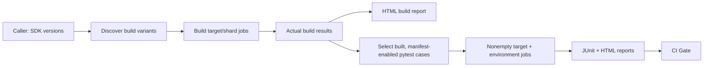

# ESP-IDF component CI

[build_and_run_apps.yml](workflows/build_and_run_apps.yml) owns events, PR labels,
changed-component selection, SDK versions and the final `CI Gate`.
[reusable-ci.yml](workflows/reusable-ci.yml) runs this pipeline for each SDK:



Discovery uses `idf-ci.get_all_apps` and the SDK's supported targets. This repo
adds Linux through `additional_build_targets` in [.idf_build_apps.toml](../.idf_build_apps.toml);
other preview targets remain excluded. Shards contain up to 20 discovered
app/configuration variants, including apps without tests. Dependency filtering
may leave a shard with fewer builds or none.

After all builds for an SDK succeed, test planning intersects successful
`(app, target, config)` records, manifest test permissions and collected pytest
cases. Every required app must qualify. Empty groups create no test jobs;
missing metadata or runtime collection differing from planned node IDs fails CI.
SDK pipelines are independent.

## Adding versions, apps and tests

1. Add an SDK Docker tag to [ci-matrix.json](ci-matrix.json).
2. Add the app and configurations: `sdkconfig.ci` for `default`,
   `sdkconfig.ci.<name>` for named variants. Adding a default can expand coverage;
   do not add one merely to satisfy the consistency report.
3. Add `pytest_*.py` with explicit targets and environment markers:

   ```python
   @pytest.mark.generic
   @pytest.mark.parametrize('target', ['esp32'], indirect=['target'])
   def test_component(dut):
       dut.run_all_single_board_cases()
   ```

Parameterize `config` for named variants. Keep SDK/target restrictions in the
component's `.build-test-rules.yml`, registered in `.idf_build_apps.toml`:

```yaml
component/test_apps:
  disable_test:
    - if: IDF_TARGET == "esp32" and IDF_VERSION_MAJOR == 5
      temporary: true
      reason: "Describe the failure and reference its investigation or CI run"
```

`disable` prevents builds and tests; `disable_test` keeps builds. Linux is a
default build target, so use `disable` with `IDF_TARGET == "linux"` for apps
whose host builds are not enabled. A more specific folder rule replaces its
parent: update the existing rule, since rules are not merged across folders.
Restrictions apply to whole app variants, including hardware and QEMU cases
sharing a binary. There are no pytest version markers or central target allowlists.
Temporary exclusions do not expire automatically or prove a target unsupported.
Explicit pytest targets can expose previously undiscovered tests: validate new coverage.

## Runners

`idf-ci` registers [pytest.ini](../pytest.ini) `env_markers` and groups cases by
target, environment and runner tags. The GitHub adapter adds `self-hosted`,
`linux`, `docker`, retains custom requirements, and maps ESP32 Ethernet to
`ESP32-ETHERNET-KIT`. QEMU uses Docker runners without physical target labels;
Linux uses `ubuntu-latest`. Their embedded services are `idf,qemu` and `idf`.
Multi-DUT and QEMU targets other than S3/C3 fail planning.

Declare valid target/environment pairs in pytest, as in `esp_encrypted_img`:
ESP32/S2/S3 use `generic`, C3/S3 use `qemu`. Enable additional targets by updating
their manifest restrictions and checking runner availability.

## Reusing the workflow

```yaml
jobs:
  ci:
    strategy:
      fail-fast: false
      matrix:
        idf_version: [release-v5.4, release-v6.0]
    uses: espressif/idf-extra-components/.github/workflows/reusable-ci.yml@YOUR_CI_COMMIT_SHA
    with:
      idf_version: ${{ matrix.idf_version }}
      run_tests: true
```

| Input | Default | Meaning |
| --- | --- | --- |
| `idf_version` | Required | Docker tag of `espressif/idf` |
| `run_tests` | `false` | Enable runtime planning and execution |
| `modified_files` | `[]` | JSON array for dependency-based build filtering |
| `modified_components` | `[]` | JSON array of changed components |
| `pipeline_id` | SDK tag | Unique artifact namespace for repeated SDK invocations |

Consumers supply `.idf_build_apps.toml`, manifests and pytest configuration.
Empty change arrays request a full build. Build-only runs retain reports and
metadata but omit runtime binaries and tests. Tools are pinned; build setup
preserves the SDK's component-manager constraints and compiler warning flags.

Reserve `.github/ci-source`: helpers are sparsely checked out from the called
workflow's exact `job.workflow_repository` and `job.workflow_sha` (GitHub.com).
This avoids remote action staging following dangling submodule symlinks.
Archives preserve relative paths and executable bits; missing runtime binaries
fail packaging. Configure pytest to locate builds: this repo uses `build_@t_@w`,
the local `build_dir` fixture's skip-on-missing behavior, and `idf-ci`'s `config`.

## Reports and diagnostics

| Artifact | Contents |
| --- | --- |
| `build_test_consistency_<pipeline_id>` | Native inventory per SDK; missing configurations are diagnostic, collection errors fail |
| `build_report_<pipeline_id>` | Actual build statuses, configurations and reasons, including failures; incomplete metadata fails reporting |
| `test_selection_<pipeline_id>` | Exact planned pytest node IDs |
| `test_results_<pipeline_id>_<target>_<group>` | JUnit XML and SDK/target/environment/runner context |
| `test_report_<pipeline_id>` / `test_report` | Offline HTML per SDK / across SDKs |
| `test_diagnostics_<pipeline_id>_<target>_<group>` | Failed-run pytest/debug/DUT logs, package versions and serial ports before/after execution |

Extract HTML artifacts and open locally. Test counts describe recorded
JUnit/Unity cases, not Python functions. Missing XML remains visible; absent
cases are never invented as passed or skipped. Manifest-disabled/unbuilt cases
appear in planning logs. Diagnostics stay separate from aggregation to avoid
counting nested Unity XML twice; pytest failures retain their exit status.

Require `CI Gate` for branch protection: failed/cancelled dependencies fail it,
intentional skips do not. `PR: build only` disables tests; `PR: test all apps`
and global CI/config changes request full builds. Fork/Dependabot runs retain
summaries without attempting privileged result publishing.

## Local validation

```sh
python3 -m unittest discover -s .github/tests -p 'test_*.py'
actionlint -ignore '^property "workflow_(repository|sha)" is not defined in object type'
```

The narrow Actionlint exclusion supports versions missing GitHub's workflow
identity fields. In an ESP-IDF environment, install
`actions/ci-tools/requirements.txt`, run `idf-ci test collect -m ''`, and inspect
shards with `generate_build_matrix.py`. Reproduce planning with
`generate_test_matrix.py` and downloaded `build_info_*.json`, the original
`BUILD_MATRIX` and a writable `GITHUB_OUTPUT`. Hardware tests require boards.
