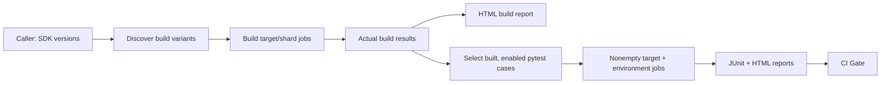

# ESP-IDF component CI

[build_and_run_apps.yml](workflows/build_and_run_apps.yml) owns events, PR labels,
changed-component selection, SDK versions and the final `CI Gate`.
[reusable-ci.yml](workflows/reusable-ci.yml) runs this pipeline for each SDK:



Discovery uses `idf-ci.get_all_apps` and the SDK's supported targets. This repo
adds Linux through `additional_build_targets` in [.idf_build_apps.toml](../.idf_build_apps.toml);
other preview targets remain excluded. Shards contain up to 20 discovered
app/configuration variants, including apps without tests. Dependency filtering
may leave a shard with fewer builds or none.

After all builds for an SDK succeed, test planning intersects successful
`(app, target, config)` records and collected pytest cases. Pytest `disable_test`
markers exclude nodes during discovery. Every required app must qualify. Empty groups create no test jobs;
missing metadata or runtime collection differing from planned node IDs fails CI.
SDK pipelines are independent.

## Adding versions, apps and tests

1. Add an SDK Docker tag to [ci-matrix.json](ci-matrix.json).
2. Add the app and configurations: `sdkconfig.ci` for `default`,
   `sdkconfig.ci.<name>` for named variants. Adding a default can expand coverage;
   do not add one merely to satisfy the `check_test_scripts_build_test_rules` report.
3. Add `pytest_*.py` with explicit targets and environment markers:

   ```python
   @pytest.mark.generic
   @pytest.mark.parametrize('target', ['esp32'], indirect=['target'])
   def test_component(dut):
       dut.run_all_single_board_cases()
   ```

Parameterize `config` for named variants. Keep build restrictions in the
component's `.build-test-rules.yml`, registered in `.idf_build_apps.toml`:

```yaml
component/test_apps:
  disable:
    - if: CONFIG_NAME == "rmt" and SOC_RMT_SUPPORTED != 1
      reason: RMT configuration requires RMT hardware
```

`disable` prevents builds and tests. To retain builds but disable runtime tests,
add `@pytest.mark.disable_test('IDF_TARGET == "esp32" and IDF_VERSION_MAJOR == 5',
reason='Describe the failure and reference its investigation or CI run')` to the
pytest function. Shared rules can be placed in a module's `pytestmark` list.
Linux is a
default build target, so use `disable` with `IDF_TARGET == "linux"` for apps
whose host builds are not enabled. A more specific folder rule replaces its
parent: update the existing rule, since rules are not merged across folders.
Build restrictions apply to whole app variants. Test markers apply to individual
functions or parameter variants, so hardware and QEMU can be disabled separately
even when they share a binary. There is no central target allowlist.
Temporary exclusions do not expire automatically or prove a target unsupported.
Explicit pytest targets can expose previously undiscovered tests: validate new coverage.

## Runners

`idf-ci` registers [pytest.ini](../pytest.ini) `env_markers` and groups cases by
target, environment and runner tags. The GitHub adapter adds `self-hosted`,
`linux`, `docker`, retains custom requirements, and maps ESP32 Ethernet to
`ESP32-ETHERNET-KIT`. QEMU uses Docker runners without physical target labels;
Linux uses `ubuntu-24.04`. Their embedded services are `idf,qemu` and `idf`.
Multi-DUT and QEMU targets other than S3/C3 fail planning.

Declare valid target/environment pairs in pytest, as in `esp_encrypted_img`:
ESP32/S2/S3 use `generic`, C3/S3 use `qemu`. Enable additional targets by updating
their test exclusion markers and checking runner availability.

## Reusing the workflow

```yaml
jobs:
  ci:
    strategy:
      fail-fast: false
      matrix:
        idf_version: [release-v5.4, release-v6.0]
    uses: espressif/idf-extra-components/.github/workflows/reusable-ci.yml@YOUR_CI_COMMIT_SHA
    with:
      idf_version: ${{ matrix.idf_version }}
      run_tests: true
```

| Input | Default | Meaning |
| --- | --- | --- |
| `idf_version` | Required | Docker tag of `espressif/idf` |
| `run_tests` | `false` | Enable runtime planning and execution |
| `modified_files` | `[]` | JSON array for dependency-based build filtering |
| `modified_components` | `[]` | JSON array of changed components |
| `pipeline_id` | SDK tag | Unique artifact namespace for repeated SDK invocations |

Consumers supply `.idf_build_apps.toml`, manifests and pytest configuration.
Empty change arrays request a full build. Build-only runs retain reports and
metadata but omit runtime binaries and tests. Tools are pinned; build setup
preserves the SDK's component-manager constraints and compiler warning flags.

Reserve `.github/ci-source`: helpers are sparsely checked out from the called
workflow's exact `job.workflow_repository` and `job.workflow_sha` (GitHub.com).
This avoids remote action staging following dangling submodule symlinks.
Archives preserve relative paths and executable bits; missing runtime binaries
fail packaging. Configure pytest to locate builds: this repo uses `build_@t_@w`,
the local `build_dir` fixture's skip-on-missing behavior, and `idf-ci`'s `config`.

## Reports and diagnostics

| Artifact | Contents |
| --- | --- |
| `check_test_scripts_build_test_rules_<pipeline_id>` | Native HTML inventory and JSON coverage audit per SDK; enabled tests without build definitions fail, unexplained build-only variants warn |
| `build_report_<pipeline_id>` | Actual build statuses, configurations and reasons, including failures; incomplete metadata fails reporting |
| `test_selection_<pipeline_id>` | Exact planned pytest node IDs |
| `test_results_<pipeline_id>_<target>_<group>` | JUnit XML and SDK/target/environment/runner context |
| `test_report_<pipeline_id>` / `test_report` | Offline HTML per SDK / across SDKs |
| `test_diagnostics_<pipeline_id>_<target>_<group>` | Failed-run pytest/debug/DUT logs, package versions and serial ports before/after execution |

Extract HTML artifacts and open locally. Test counts describe recorded
JUnit/Unity cases, not Python functions. Missing XML remains visible; absent
cases are never invented as passed or skipped. Disabled nodes are deselected
during collection; unbuilt variants are excluded during planning. Diagnostics stay separate from aggregation to avoid
counting nested Unity XML twice; pytest failures retain their exit status.

Each IDF version has one workflow summary after its build and test jobs finish.
It combines stage statuses and links to the `check_test_scripts_build_test_rules`, build and test reports.
Build-only and failed runs also receive a summary; unavailable reports are omitted.

Coverage is checked per `(app, target, config)`, not just per target. Each build
candidate should have an enabled test, an explicitly disabled test, or an explicit
build-only declaration. Several tests can cover the same build. Disabled nodes
are retained only for this audit, including their reasons; runtime discovery
still excludes them. The audit checks definitions, not successful compilation
or hardware execution. An unnamed build configuration matches pytest's `default`.
Tests for an existing app on targets absent from the selected SDK are listed as
`unsupported`, rather than missing build definitions. The SDK's preview targets
and Linux remain in scope. Missing app paths and missing configurations on known
targets still fail, with the exact app, target, config and test IDs in the log.

For applications intentionally built without tests, an optional
`.github/build-only-apps.json` records the reason. Entries match an exact app
directory; an optional `condition` uses the same IDF boolean expressions as
test exclusions:

```json
[
  {
    "app": "component/examples/compile_only_example",
    "condition": "CONFIG_NAME == \"default\"",
    "reason": "Compilation example; no automated runtime test is provided"
  }
]
```

Without a declaration, a build without tests produces a warning. A declaration
never hides an enabled test referencing a missing build configuration.

Require `CI Gate` for branch protection: failed/cancelled dependencies fail it,
intentional skips do not. `PR: build only` disables tests; `PR: test all apps`
and global CI/config changes request full builds. Fork/Dependabot runs retain
summaries without attempting privileged result publishing.

## Local validation

To disable a particular pytest function or parameter variant during discovery,
use a test marker (not an environment/runner marker):

```python
@pytest.mark.disable_test(
    targets=['esp32c3'], configs=['rmt'], reason='Waiting for runner validation',
)
@pytest.mark.parametrize('config', ['rmt', 'uart'], indirect=True)
@pytest.mark.parametrize('target', ['esp32', 'esp32c3'], indirect=True)
def test_onewire_bus(dut, config):
    ...
```

This removes only the ESP32-C3/RMT node before `idf-ci` groups test jobs.
Selectors are combined with AND; values within a selector are alternatives.
Omit a selector to match any value, or omit both to disable the whole test.
Markers can also be placed on `pytest.param`; multiple matching rules disable
the node. A reason is required and logged during collection. These rules also
apply to local pytest runs. Test exclusions live beside tests; build eligibility
stays in manifests. A marker cannot enable testing of an unbuilt application.

The optional first argument uses the same boolean parser as manifest `if` rules:

```python
@pytest.mark.disable_test(
    'CONFIG_NAME == "rmt" and (IDF_VERSION < "5.5" or SOC_RMT_SUPPORTED != 1)',
    reason='RMT needs a supported SDK and target',
)
```

Expressions support `IDF_TARGET`, `CONFIG_NAME`, `IDF_VERSION`, version parts,
and the SDK's SoC capabilities, with manifest operators such as `and`, `or`,
`in` and comparisons. Conditions and optional target/config selectors must
match the same application. Syntax errors fail collection. Discovery evaluates
conditions inside the selected SDK; CI workers use the frozen `TEST_NODES`
selection instead of re-evaluating them without an SDK.

```sh
python3 -m unittest discover -s .github/tests -p 'test_*.py'
actionlint -ignore '^property "workflow_(repository|sha)" is not defined in object type'
```

The narrow Actionlint exclusion supports versions missing GitHub's workflow
identity fields. In an ESP-IDF environment, install
`actions/ci-tools/requirements.txt`, run `idf-ci test collect -m ''`, and inspect
shards with `generate_build_matrix.py`. Reproduce planning with
`generate_test_matrix.py` and downloaded `build_info_*.json`, the original
`BUILD_MATRIX` and a writable `GITHUB_OUTPUT`. Hardware tests require boards.
