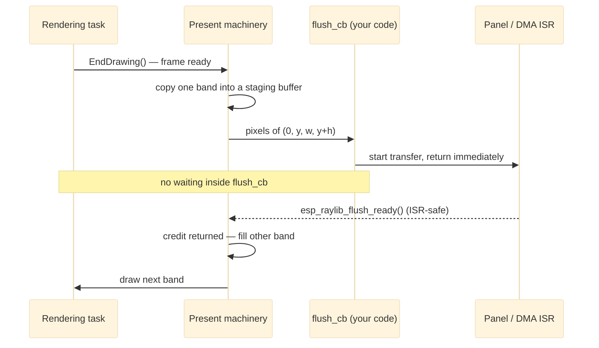

# Display Configuration

Display integration in `esp_raylib.h` centers on [esp_raylib_add_display()](api.md#function-esp_raylib_add_display), the [esp_raylib_flush_cb_t](api.md#typedef-esp_raylib_flush_cb_t) callback type and [esp_raylib_flush_ready()](api.md#function-esp_raylib_flush_ready). See the [API Reference](api.md) for their signatures, parameters and the full field-by-field contract. This page focuses on how they fit together at runtime.

## The frame pipeline

Your application creates the panel driver and owns the rendering task; the component owns the framebuffer and the present machinery. [esp_raylib_add_display()](api.md#function-esp_raylib_add_display) registers the panel **before** `InitWindow()`. Each finished band (or the whole frame when `chunk_rows` is 0) travels to your `flush_cb`, which starts the transfer and returns. The component then waits for one [esp_raylib_flush_ready()](api.md#function-esp_raylib_flush_ready) — the completion credit for the **previous** transfer (`InitWindow()` seeds the first one) — before reusing the other buffer, while the transfer just submitted stays in flight.

The two internal staging buffers (`chunk_rows > 0`) let the next band be filled while the current one is still being transferred.

## Practical notes

These are the points that are easy to get wrong when wiring up the callback; the complete contract is in the [API Reference](api.md).

- **Where to call [esp_raylib_flush_ready()](api.md#function-esp_raylib_flush_ready):** from the SPI transfer-done ISR for band DMA (`on_color_trans_done`, this function is ISR-safe), inline for a synchronous copy inside `flush_cb`, or from the full-frame event that releases the previous buffer for a self-swapping panel (`chunk_rows == 0`). For that last case the event must be edge-triggered per flush — a periodic VSYNC does not express "this buffer is free".
- **Buffer lifetime:** with `chunk_rows > 0`, `pixels` is a staging band valid only until its `flush_ready`. With `chunk_rows == 0`, it is the color buffer itself (placed in PSRAM when `CONFIG_RAYLIB_USE_PSRAM` is on) and stays owned by the panel until a later frame reports it done — do not keep reading it after that ready.
- **In flight:** up to two transfers can overlap, so report completions in the order the transfers were started. A missing `flush_ready` during a window deadlocks the present task.
- **IRAM safety:** if the LCD ISR is IRAM-safe, mark the callback `IRAM_ATTR` and allocate its `user_data` from internal RAM. [esp_raylib_flush_ready()](api.md#function-esp_raylib_flush_ready) itself is `IRAM_ATTR` and only touches internal-RAM state.

> [!NOTE]
> **SPI panels:** A `trans_queue_depth` of at least 2 is the usual `esp_lcd` setting. The component overlaps the next band *copy* with the transfer still in flight; stock `esp_lcd` SPI still waits out the previous color DMA before the next window command.

## Rules the component does not defend at runtime

- `InitWindow(w, h)` must match the panel resolution — the config holds no size; every band covers `(0, y, w, y+h)` in panel coordinates.
- All raylib calls, `CloseWindow()` included, come from the one rendering task (raylib's own threading model).
- Only one display is currently supported: a second [esp_raylib_add_display()](api.md#function-esp_raylib_add_display) returns `NULL`.

The registration lasts for the whole process: `CloseWindow()` tears down the rendering side but keeps the registration, so `InitWindow()` can be called again without repeating [esp_raylib_add_display()](api.md#function-esp_raylib_add_display). `user_data` must outlive the registration.

## Mirroring

The [mirror](api.md#struct-esp_raylib_display_config_t) flag flips the screen color buffer only — a RenderTexture (`BeginTextureMode`) keeps the API orientation. Zero follows OpenGL, where row 0 is the bottom of the scene. Set `ESP_RAYLIB_MIRROR_Y` for the typical LCD scanout where row 0 is the panel top, and/or `ESP_RAYLIB_MIRROR_X` to put column 0 at the right. The rasteriser writes already-mirrored pixels; bands copy in memory order.
