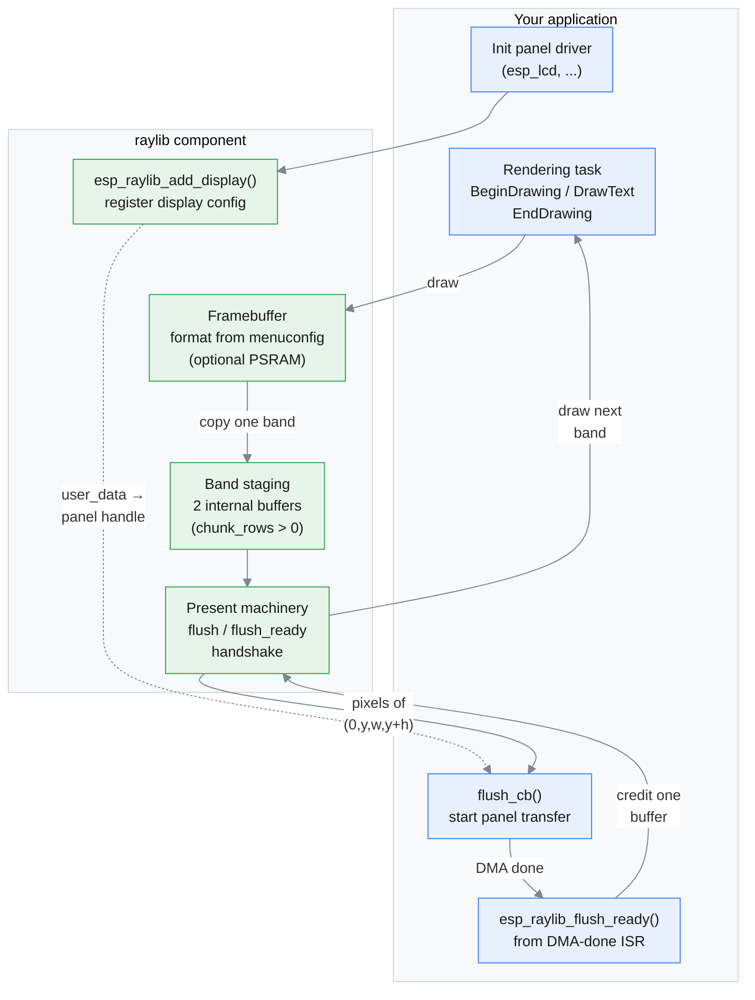

# Raylib on ESP-IDF

[Raylib](https://www.raylib.com/) is a small library for 2D graphics built around a plain C API (`InitWindow()`, `BeginDrawing()`, `DrawText()`, `EndDrawing()`). This component packages raylib for ESP-IDF and runs it on raylib's **software renderer**, so it works on any ESP chip — no GPU required.

Your code draws into an in-memory framebuffer using the familiar raylib 2D API. The component hands the finished pixels to your display through a single flush callback that you write; the panel driver itself stays entirely in your application.

## What this component provides

- The upstream 2D drawing API, built from upstream's own CMake files
- The software rasteriser (rlsw): 2D shapes, textures and text
- A framebuffer pixel format chosen in `menuconfig`: RGB565 for most panels, RGBA8888, RGB888 or RGB332
- Panel delivery through one flush callback — DMA of one buffer overlaps drawing or copying the next
- Large buffers in PSRAM (optional) and a set of asset loaders you enable as needed

The 2D drawing API is the upstream one. Audio, 3D models, gestures and window/input devices are **not** adapted yet.

## How a frame reaches the screen

The diagram below shows the pipeline. Your application owns the panel driver and the render task; the component owns the framebuffer and the present machinery that bridges raylib to your `flush_cb`.

The two internal staging buffers let the next band be filled while the current one is still being transferred. [esp_raylib_flush_ready()](api.md#function-esp_raylib_flush_ready) is the credit signal that tells the component a buffer can be reused.

## Where to go next

- [Getting Started](getting-started.md) — add the dependency, register a display and draw your first frame
- [Display Configuration](display.md) — the callback contract, band staging and the rules around `InitWindow()`
- [Configuration Options](configuration.md) — `menuconfig` options for format, PSRAM and asset loaders
- [API Reference](api.md) — generated from the component's public header

> [!NOTE]
> This guide documents the ESP-IDF packaging layer. For the full upstream 2D drawing API, see the [raylib cheatsheet](https://www.raylib.com/cheatsheet/cheatsheet.html).
